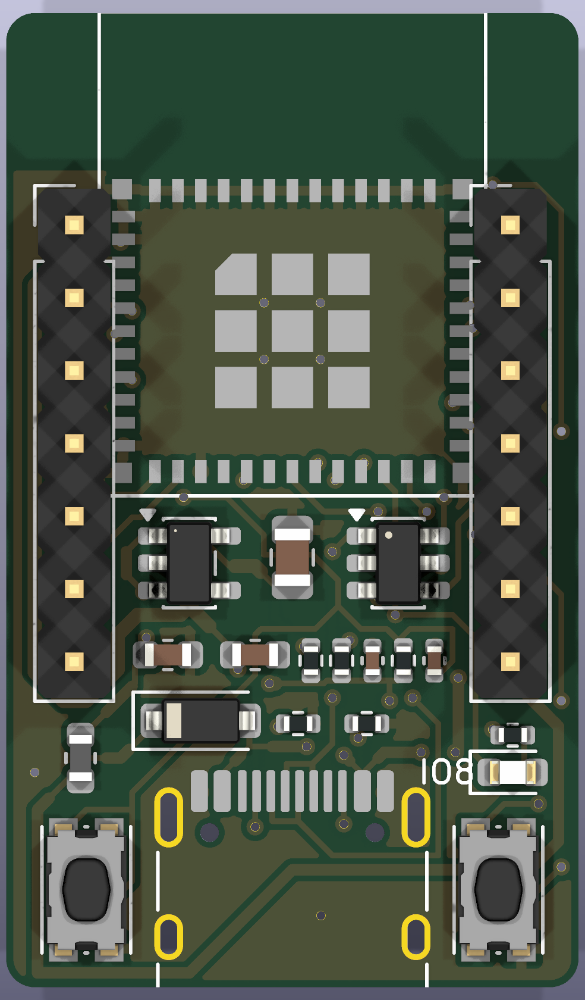
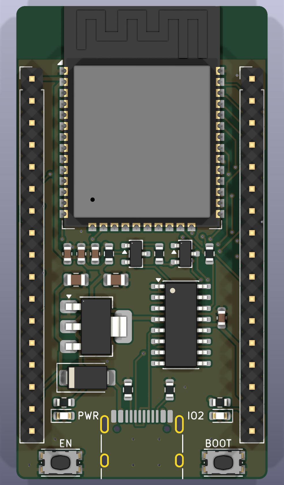
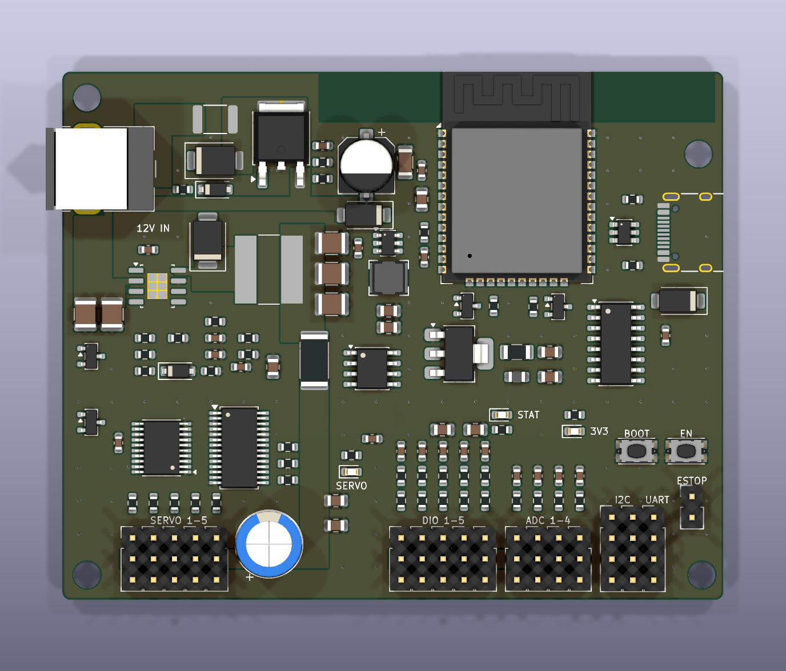

<p align="center">
  
</p>

<h1 align="center">PKT ESP32 Boards</h1>

<p align="center">
  ชุดบอร์ด ESP32 ของ <b>POKOTEAM</b> ออกแบบด้วย KiCad 10 และสร้างจากสคริปต์ทั้งหมด
</p>

<p align="center">
  
  
  
</p>

---

## บอร์ดทั้งหมด

| | บอร์ด | ขนาด | จุดเด่น | สถานะ | Branch |
|---|---|---|---|---|---|
|  | **[PKT ESP32-C3 Mini](boards/c3-mini)** | 20 × 34 มม. | จิ๋ว ไฟสะอาด USB-C ในตัว โลโก้ PKT | ไฟล์พร้อมสั่ง PCBA | `board/c3-mini` |
|  | **[ESP32 Dev Board](boards/esp32-devboard)** | 29 × 54.6 มม. | เสียบ breadboard ได้ CH340C auto-reset | มี Gerber | `board/esp32-devboard` |
|  | **[Robot Arm Controller](boards/arm-controller)** | 80 × 64 มม. | servo 5 ช่อง E-stop วัดกระแส แยกไฟ logic | วงจรเสร็จ เดินลายยังไม่เสร็จ | `board/arm-controller` |

> ยังไม่มีบอร์ดใดผ่านการทดสอบกับของจริง ตรวจด้วย ERC และ DRC ของ KiCad แล้วเท่านั้น

## โครงสร้าง repo

```text
PKT-ESP32-Boards
├── assets/                  โลโก้
└── boards/
    ├── c3-mini/             PKT ESP32-C3 Mini
    ├── esp32-devboard/      ESP32 Dev Board
    └── arm-controller/      Robot Arm Controller
```

แต่ละบอร์ดมีโครงสร้างเดียวกัน

| โฟลเดอร์ | เนื้อหา |
|---|---|
| `docs/` | ภาพวงจร ภาพบอร์ด และคำอธิบาย |
| `fab/` | Gerber, BOM, ตำแหน่งอุปกรณ์ และรายงาน ERC/DRC |
| `tools/` | สคริปต์สร้าง schematic และ PCB จาก `design.py` |

## Branch

| Branch | ใช้ทำอะไร |
|---|---|
| `main` | รวมทุกบอร์ด |
| `board/c3-mini` | งานของ ESP32-C3 Mini เท่านั้น |
| `board/esp32-devboard` | งานของ Dev Board เท่านั้น |
| `board/arm-controller` | งานของ Arm Controller เท่านั้น |

แก้บอร์ดไหนให้ทำใน branch ของบอร์ดนั้น แล้วค่อย merge เข้า `main`

## วิธีเปิดและสั่งผลิต

เปิดไฟล์ `.kicad_pro` ของบอร์ดใน KiCad 10

สั่ง C3 Mini ผ่าน JLCPCB ตามขั้นตอนใน [HOW_TO_ORDER.txt](boards/c3-mini/fab/HOW_TO_ORDER.txt)

แก้แบบจาก `tools/design.py` แล้วรัน `tools/build.sh` ในบอร์ดที่มีสคริปต์นี้ สคริปต์ใช้ KiCad บน macOS ที่ `/Applications/KiCad`
