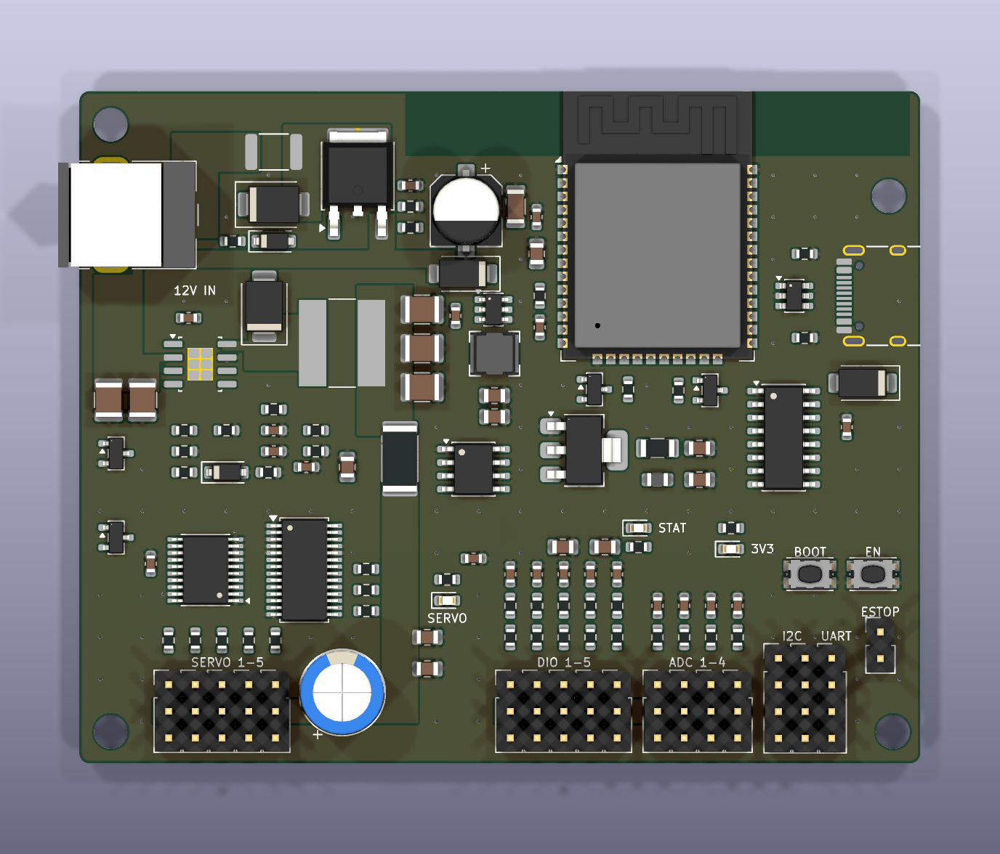
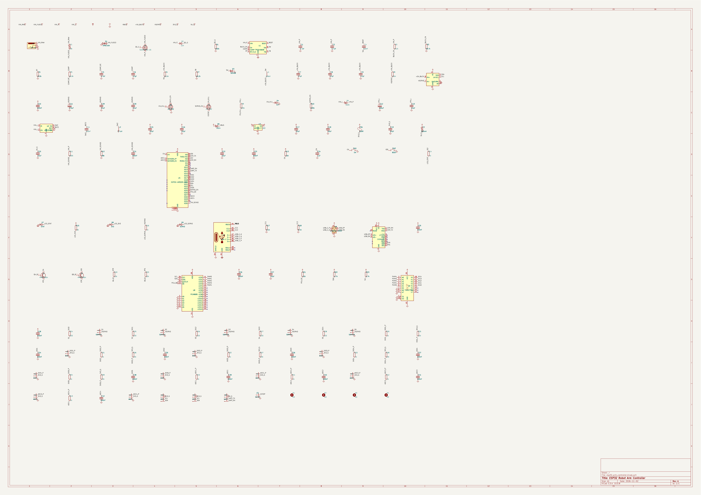

  

<h1 align="center">PKT ESP32 Robot Arm Controller</h1>

บอร์ดควบคุมแขนกล 5 แกนสำหรับ SG90/MG90S ขนาด 80 × 64 มม. ใช้ adapter 12V

> **ยังสั่งผลิตไม่ได้** วงจรเสร็จแล้ว แต่การเดินลายยังไม่สำเร็จ ภาพด้านบนคือการวางอุปกรณ์

## บอร์ดนี้คืออะไร

บอร์ดควบคุมแขนกลที่แยกไฟ servo ออกจากไฟของ ESP32 เพื่อไม่ให้บอร์ดรีเซ็ตเมื่อ servo กระชากไฟ
มีปุ่มหยุดฉุกเฉิน และจ่ายไฟ servo ก็ต่อเมื่อ firmware สั่งเปิด

## เหมาะกับงานแบบไหน

- แขนกลตั้งโต๊ะ 5 แกน
- งานหยิบวางและโครงงานหุ่นยนต์
- ระบบที่ต้องอ่าน limit switch และตำแหน่งจากโพเทนชิออมิเตอร์

## จุดเด่น

| หัวข้อ | รายละเอียด |
|---|---|
| PWM | PCA9685 สร้างสัญญาณแยกจาก CPU |
| สัญญาณ servo | บัฟเฟอร์ 74AHCT541 ระดับ 5V |
| ไฟ servo | บัค TPS54560B 5V ค่าอิงจาก datasheet ของ TI |
| ไฟ logic | บัค AP63205 แยกต่างหาก มีไดโอดและ C hold-up |
| ความปลอดภัย | E-stop แบบ fail-safe และบูตมา servo จะดับ |
| วัดผล | INA219 วัดกระแสและแรงดันราง servo |

## พอร์ต

| พอร์ต | จำนวน |
|---|---|
| Servo (S + -) | 5 |
| DIO พร้อมตัวกรอง | 5 |
| ADC พร้อมตัวกรอง | 4 |
| I2C | 2 |
| UART | 1 |
| ESTOP | 1 |

ต้องต่อสวิตช์ NC หรือจั๊มเปอร์ที่ ESTOP ไม่เช่นนั้น servo จะไม่ได้ไฟ

## วงจร

ดูแบบซูมได้ที่ [schematic.pdf](docs/schematic.pdf) และดูประมาณราคาอุปกรณ์ได้ที่ [bom_with_prices.csv](bom_with_prices.csv)
