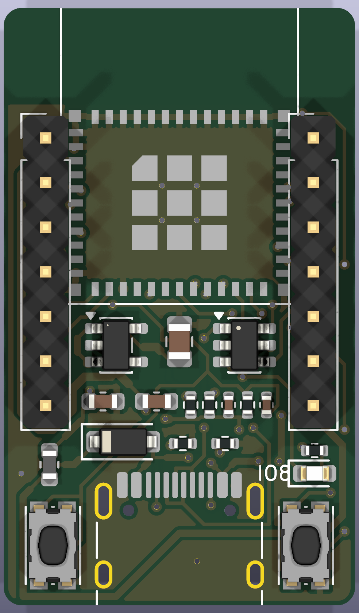
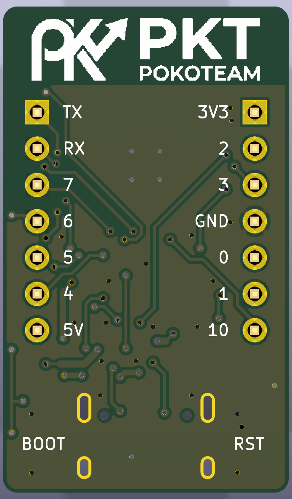
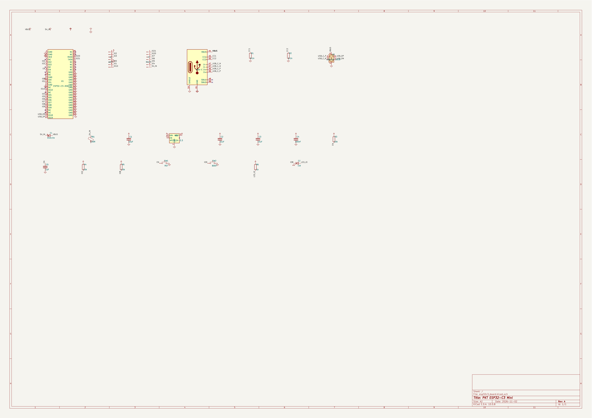

# PKT ESP32-C3 Mini

บอร์ด ESP32-C3 ขนาด 20 × 34 มม. เน้นเล็กและไฟสะอาด สั่ง PCBA ผ่าน JLCPCB ได้

| ด้านบน | ด้านหลัง |
|---|---|
|  |  |

ไฟล์สั่งผลิตอยู่ใน `fab/` เริ่มที่ [HOW_TO_ORDER.txt](fab/HOW_TO_ORDER.txt) ยังไม่ได้ทดสอบกับบอร์ดจริง

[คำอธิบายเต็ม](docs/about.txt) · [Schematic PDF](docs/schematic.pdf)

