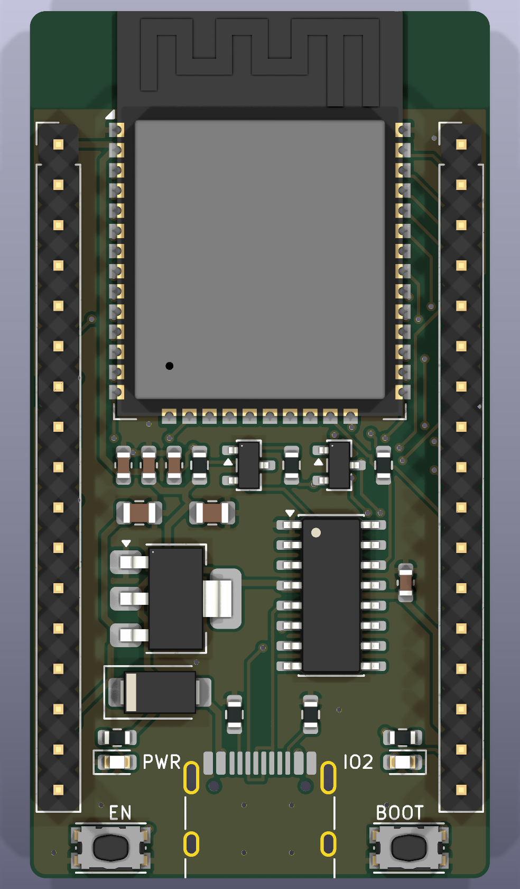
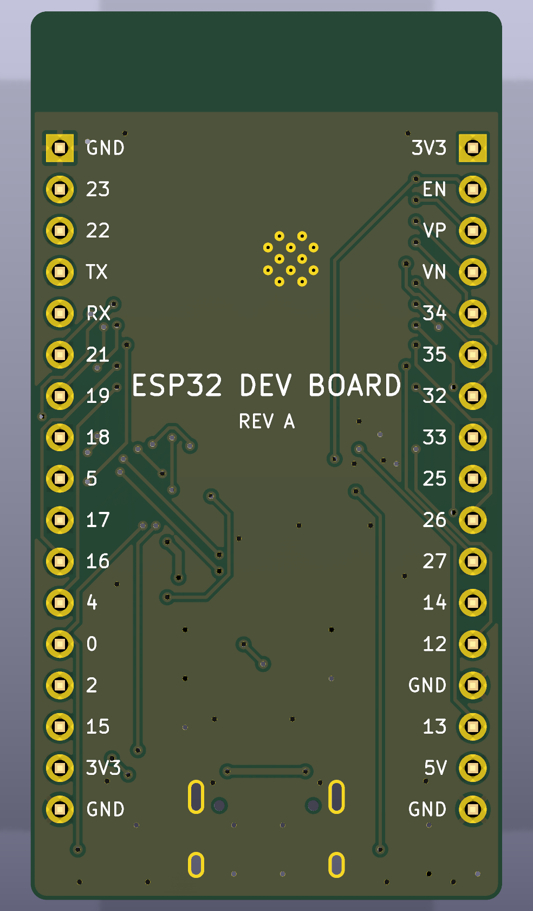
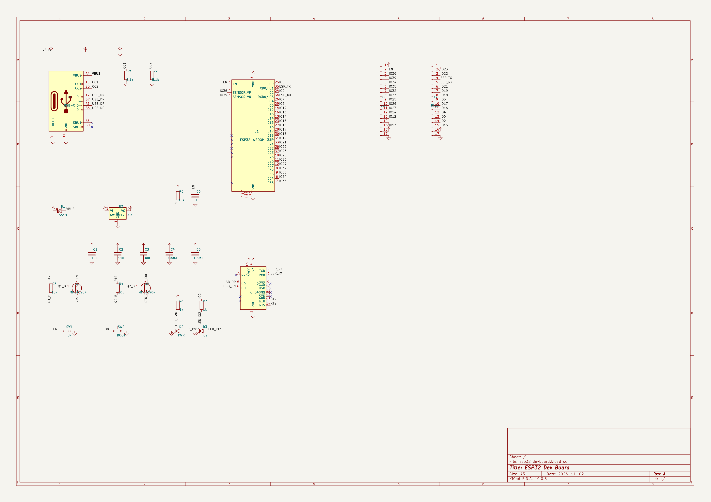

# ESP32 Dev Board

บอร์ดพัฒนา ESP32-WROOM-32E ขนาด 29 × 54.6 มม. เสียบ breadboard ได้

| ด้านบน | ด้านหลัง |
|---|---|
|  |  |

Gerber อยู่ใน `fab/` ยังไม่ได้ทดสอบกับบอร์ดจริง

[คำอธิบายเต็ม](docs/about.txt) · [Schematic PDF](docs/schematic.pdf)

